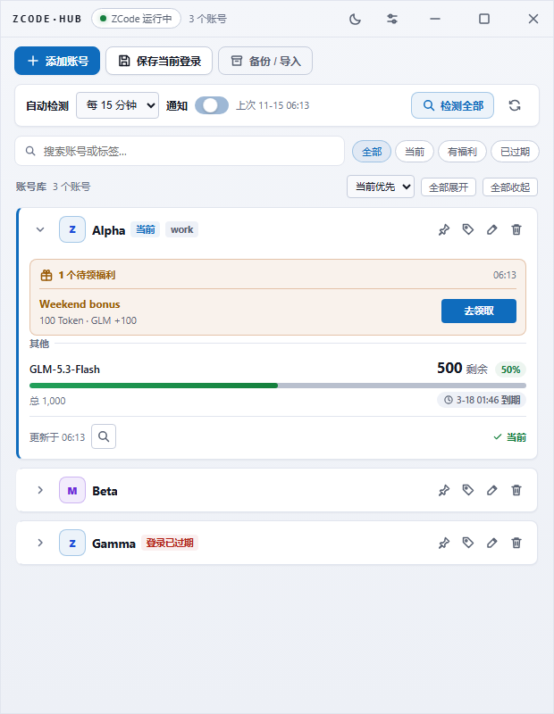

# ZCode Hub

[简体中文](README.md) | **English**

[](../../actions/workflows/ci.yml)
[](../../actions/workflows/release.yml)
[](LICENSE)


**A Tauri 2 desktop tool for one-click switching between multiple ZCode accounts, with quota display, benefit detection and per-account device identity.**

Switches only the login identity — projects, sessions and settings stay untouched. Local-first: no first-party telemetry, no remote storage; quota & benefit queries go straight to official endpoints (benefit detection reports launch events like the official client; auto-check can be disabled).

> ⚠️ Unofficial tool, not affiliated with Z.ai / Zhipu (BigModel). Respect their terms of service; account risk is yours.

<p align="center"></p>

*Screenshot shows built-in demo data, not real accounts. Wide layout: [docs/screenshots/main-1200.png](docs/screenshots/main-1200.png).*

## Features

- **Multi-account switching** — one click, auto-preserved current login (no lost accounts), client auto-restart
- **Dual-provider OAuth** — built-in Z.AI / BigModel login flows with business-token exchange and normalized profiles
- **Per-account device identity** — each account gets its own deviceMid + arms_uid written into the client on switch
- **Quota display** — grouped by plan (base / limited-time), humanized numbers, expiry dates
- **Benefit detection & one-click claim** — client-banner source (`marketing/touch`, `billing/preview` fallback); per-account, all-accounts or tray trigger; scheduled auto-check with notifications; claim with a manual captcha in your browser (no automated claiming)
- **Encrypted snapshots** — AES-256-GCM whole-file encryption, random key sealed with Windows DPAPI (bound to current user + machine)
- **Password backups** — portable `.zhb` v2 bundles (PBKDF2-HMAC-SHA256 120k + AES-256-GCM) re-encrypted for the target machine
- **UX** — light / dark theme, custom titlebar, window geometry memory, autostart, close-to-tray, start minimized, rename & manual reorder, undo delete, claim history, 2/3-column wide layout, bilingual UI (zh/en)
- **Account organization** — search, current/has-benefits/expired filters, custom tags, pinning; tray quick-switch submenu and `Ctrl+Shift+Z` global toggle
- **Alerts & recovery** — quota expiry / below-10% notifications, periodic update alerts, daily local auto-backup (7 copies) plus portable `.zhb`, import preview (new/duplicate/needs re-login)
- **Maintainability** — single-instance guard, redacted diagnostics export, claim-history JSON export, Playwright functional E2E with failure screenshots, cargo-deny supply-chain gate

## Install

Grab `ZCode Hub_x.x.x_x64-setup.exe` from [Releases](../../releases). Windows 10/11 x64 only.

## Usage

| Scenario | Action |
|---|---|
| Add account | "Add account" → pick Z.AI / BigModel → finish official login in browser |
| Switch | "⇄ Switch to this" on a card; the client restarts automatically |
| Check benefits | Card 🔍 (single) / "Check all" / tray menu "Check benefits now" |
| Claim | When detected, "Claim" opens a browser captcha; Hub submits the claim and refreshes automatically |
| Backup / migrate | "Backup / Import" → set password → export `.zhb` → import on another machine (v2 re-encrypts fields for the target) |
| To tray | Titlebar ✕ follows the close behavior setting (tray or quit); real exit = tray icon → Quit |
| Find an account | Search box + filter chips; pin from the card, edit tags from the tag button |
| Switch without opening | Tray → Quick switch, or `Ctrl+Shift+Z` to toggle the window |
| Recover / migrate | Settings → "Back up now" for a local restore point; use `.zhb` for cross-machine migration |

## Security model

See [SECURITY.md](SECURITY.md) for the full data-storage & encryption design. Highlights:

- All data lives in `%APPDATA%\Roaming\zcode-hub`; no first-party telemetry, no remote storage (benefit detection reports launch events like the official client; auto-check can be disabled)
- Snapshots are AES-256-GCM encrypted with a random key sealed by DPAPI — copied files are undecryptable elsewhere
- All writes are atomic (temp + rename); account ids are whitelisted against path traversal; failed switches roll back; a corrupt `snapkey` fails closed instead of being regenerated
- Audit log, quota history and benefit cache use opaque hashed account keys — no emails or display names on disk
- Strict WebView CSP (`script-src 'self'`, no inline handlers — event delegation)
- Signed auto-updates (minisign pubkey embedded; updater rejects unsigned artifacts)

## Development

See [CONTRIBUTING.md](CONTRIBUTING.md) for setup, the leak-guard hooks, tests and the release process.

```bash
cd src-tauri
cargo test && cargo clippy --all-targets -- -D warnings
cargo deny check        # RustSec / licenses / bans / sources
cd ..
npm ci && npx playwright install chromium && npm run test:e2e
npx --yes @tauri-apps/cli build --bundles nsis
```

## Docs

- [Architecture & security model](docs/DESIGN.md)
- [FAQ](docs/FAQ.md)
- [Troubleshooting](docs/TROUBLESHOOTING.md)
- [Performance baseline](docs/PERFORMANCE.md)

## License

[MIT](LICENSE)
