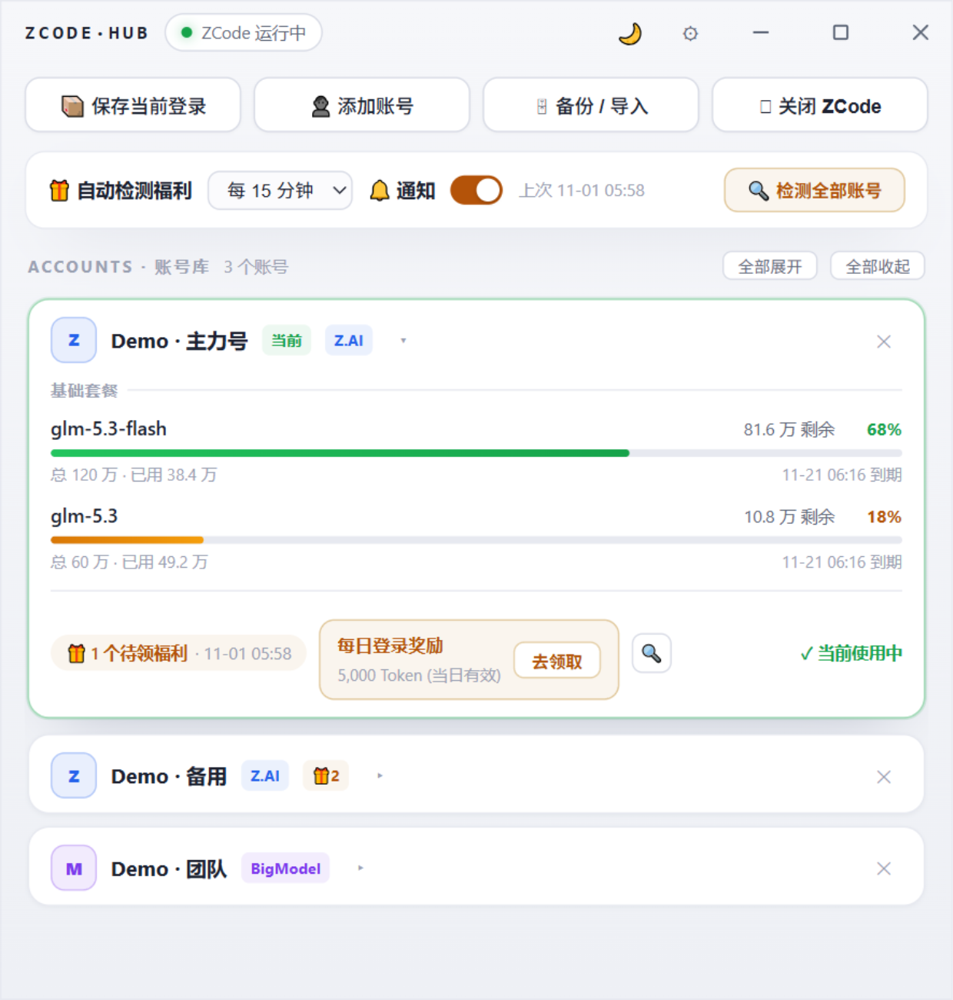

# ZCode Hub

**[简体中文] | [English](README.en.md)**

[](../../actions/workflows/ci.yml)
[](../../actions/workflows/release.yml)
[](LICENSE)


**Tauri 2 桌面工具：多个 ZCode 账号的一键切换、额度展示、福利检测与设备身份隔离。**

只换登录身份——项目、会话、设置全部共用不动。本地优先：无遥测、无远端存储，额度与福利查询直连官方接口。

> ⚠️ 非官方工具，与 Z.ai / 智谱无任何关联。请遵守服务条款，账号风险自担。

<p align="center"></p>

*截图为内置演示数据，非真实账号。*

## 功能

- **多账号切换**：一键切换登录身份，切换前自动保全当前登录（防丢号）；客户端自动重启
- **双协议 OAuth 登录**：内置 Z.AI / BigModel 两个官方登录入口，业务 token 自动交换、档案规范化
- **设备身份隔离**：每个账号绑定独立 deviceMid + arms_uid，切换时写入客户端，账号在服务端呈现独立设备标识
- **额度展示**：按套餐分组（基础 / 限时活动）、中文数量格式化、到期时间
- **福利检测**：官方 `billing/preview` 同源接口；全量 / 单账号 / 托盘右键三种触发；可设置周期自动检测 + 系统通知（开关可控）
- **加密快照**：账号存档整包 AES-256-GCM + DPAPI（绑定当前 Windows 用户），拷走文件无法解密
- **口令备份**：`.zhb` 备份包（PBKDF2-HMAC-SHA256 120k + AES-256-GCM），跨机器迁移账号
- **体验细节**：浅色 / 深色双主题、自绘标题栏、窗口几何记忆、开机自启、ZCode 路径覆盖、数据目录直达

## 安装

从 [Releases](../../releases) 下载 `ZCode Hub_x.x.x_x64-setup.exe` 安装（仅 Windows 10/11 x64）。

## 使用

| 场景 | 操作 |
|---|---|
| 添加账号 | 「添加账号」→ 选择 Z.AI / BigModel → 浏览器完成官方登录 |
| 切换账号 | 卡片「⇄ 切换到此账号」，客户端自动重启并继承全部本地数据 |
| 查福利 | 卡片 🔍（单账号）/ 设置行「检测全部」/ 托盘右键「立即检测福利」 |
| 领福利 | 检测到可领项 → 点「去领取」在 ZCode 客户端内手动完成 |
| 备份迁移 | 「备份 / 导入」→ 设口令导出 `.zhb` 到桌面 → 新机器导入 |
| 收后台 | 标题栏 ✕ = 隐藏到托盘；真正退出 = 托盘右键「退出」 |

## 安全设计

- **本地优先**：所有数据存于 `%APPDATA%\Roaming\zcode-hub`，无遥测、无远端存储
- **加密快照**：账号存档整包 AES-256-GCM，随机密钥经 Windows DPAPI 绑定当前用户与机器——文件被拷走无法解密
- **口令备份**：导出包凭口令加密（PBKDF2 120k 迭代 + 随机盐/nonce），错口令即失败
- **凭据最小化**：ZCode 自身凭据文件保持官方格式不变；Hub 不上传、不打印、不记录任何令牌
- **写入安全**：所有 JSON 原子写入（临时文件 + rename）；账号标识白名单防路径穿越
- **WebView CSP**：默认无外部脚本注入面；界面不加载任何第三方资源

## 构建

```bash
# 需要 Rust (stable) + Node.js
npx --yes @tauri-apps/cli build --bundles nsis
# 产物：src-tauri/target/release/bundle/nsis/*.exe
```

## License

[MIT](LICENSE)

## 贡献

欢迎 Issue / PR（请用 [Issue 模板](../../issues/new/choose)）。行为准则见 [CODE_OF_CONDUCT.md](CODE_OF_CONDUCT.md)；开发环境、防泄密钩子、测试与发布流程见 [CONTRIBUTING.md](CONTRIBUTING.md)；架构与设计见 [docs/DESIGN.md](docs/DESIGN.md)；安全 issue 请走 [SECURITY.md](SECURITY.md) 的私下渠道。第三方组件声明见 [NOTICE.md](NOTICE.md)。

## Roadmap

- [ ] macOS / Linux 移植（当前深度使用 Win32：DPAPI / taskkill / ShellExecuteW 等；计划公开仓库后借助免费三平台 CI 逐模块移植并验证）
- [ ] 签名自动更新依赖公开 Release 通道
- [ ] 多语言扩展开放

