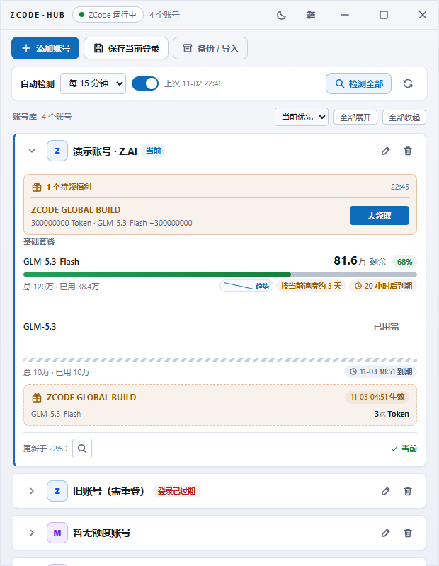

# ZCode Hub

**[简体中文] | [English](README.en.md)**

[](../../actions/workflows/ci.yml)
[](../../actions/workflows/release.yml)
[](LICENSE)


**Tauri 2 桌面工具：多个 ZCode 账号的一键切换、额度展示、福利检测与设备身份隔离。**

只换登录身份——项目、会话、设置全部共用不动。本地优先：无自建遥测、无远端存储；额度与福利查询直连官方接口（福利检测会按官方客户端行为上报启动事件，可关闭自动检测）。

> ⚠️ 非官方工具，与 Z.ai / 智谱无任何关联。请遵守服务条款，账号风险自担。

<p align="center"></p>

*截图为内置演示数据，非真实账号。宽屏布局见 [docs/screenshots/main-1200.png](docs/screenshots/main-1200.png)。*

## 功能

- **多账号切换**：一键切换登录身份，切换前自动保全当前登录（防丢号）；客户端自动重启
- **双协议 OAuth 登录**：内置 Z.AI / BigModel 两个官方登录入口，业务 token 自动交换、档案规范化
- **设备身份隔离**：每个账号绑定独立 deviceMid + arms_uid，切换时写入客户端，账号在服务端呈现独立设备标识
- **额度展示**：按套餐分组（基础 / 限时活动）、中文数量格式化、到期时间
- **福利检测与一键领取**：客户端横幅同源接口（marketing/touch，preview 兜底）；全量 / 单账号 / 托盘右键三种触发；周期自动检测 + 系统通知；可领项一键领取（浏览器内人工完成验证码，不做自动领取）
- **加密快照**：账号存档整包 AES-256-GCM + DPAPI（绑定当前 Windows 用户），拷走文件无法解密
- **口令备份**：`.zhb` v2 备份包（PBKDF2-HMAC-SHA256 120k + AES-256-GCM），跨机器/跨用户名迁移账号
- **体验细节**：浅色 / 深色、自绘标题栏、窗口几何记忆、开机自启、关闭到托盘、启动最小化、账号重命名 / 手动排序、删除撤销、领取历史、宽屏 2/3 列布局、ZCode 路径覆盖、数据目录直达
- **账号整理**：搜索、当前/有福利/已过期筛选、自定义标签、置顶；托盘「快速切换」子菜单与 `Ctrl+Shift+Z` 全局唤出
- **提醒与恢复**：额度即将到期/低于 10% 通知、新版本周期提醒、每日自动本地备份（保留 7 份）+ 手动 `.zhb` 跨机迁移、导入前预览（新增/重复/需重登）
- **可维护性**：单实例守护、脱敏诊断报告导出、领取历史 JSON 导出、Playwright 功能 E2E（失败自动截图）、cargo-deny 供应链门禁

## 安装

从 [Releases](../../releases) 下载 `ZCode Hub_x.x.x_x64-setup.exe` 安装（仅 Windows 10/11 x64）。

## 使用

| 场景 | 操作 |
|---|---|
| 添加账号 | 「添加账号」→ 选择 Z.AI / BigModel → 浏览器完成官方登录 |
| 切换账号 | 卡片「⇄ 切换到此账号」，客户端自动重启并继承全部本地数据 |
| 查福利 | 卡片 🔍（单账号）/ 设置行「检测全部」/ 托盘右键「立即检测福利」 |
| 领福利 | 检测到可领项 → 点「去领取」→ 浏览器完成人工验证码 → Hub 自动提交并刷新 |
| 备份迁移 | 「备份 / 导入」→ 设口令导出 `.zhb` 到桌面 → 新机器导入（v2 会按目标机重新加密字段） |
| 收后台 | 标题栏 ✕ = 按设置隐藏到托盘或退出；真正退出 = 托盘右键「退出」 |
| 快速找号 | 顶部搜索框 + 筛选 chips；卡片右上角图钉置顶、标签按钮编辑标签 |
| 换号（不打开窗口） | 托盘右键「快速切换」，或按 `Ctrl+Shift+Z` 呼出窗口 |
| 恢复/迁移 | 设置 →「立即备份」生成本机恢复点；「恢复最近备份」可一键回滚（恢复前自动再做安全备份）；跨机仍用「备份 / 导入」的 `.zhb` |

## 安全设计

- **本地优先**：所有数据存于 `%APPDATA%\Roaming\zcode-hub`，无自建遥测、无远端存储；福利检测按官方客户端行为上报启动事件，可关闭自动检测
- **加密快照**：账号存档整包 AES-256-GCM，随机密钥经 Windows DPAPI 绑定当前用户与机器——文件被拷走无法解密
- **口令备份**：导出包凭口令加密（PBKDF2 120k 迭代 + 随机盐/nonce），错口令即失败；v2 备份会按目标机密钥重新加密账号字段，换用户名/换机器也可恢复
- **凭据最小化**：ZCode 自身凭据文件保持官方格式不变；Hub 不上传、不打印、不记录任何令牌
- **写入安全**：所有 JSON 原子写入（临时文件 + rename）；账号标识白名单防路径穿越；切换失败自动回滚；`snapkey` 解密失败硬失败，绝不覆盖
- **隐私**：审计日志、额度历史、福利缓存的账号键均为不透明哈希，不落邮箱/昵称；审计只记事件与结果
- **WebView CSP**：默认无外部脚本注入面；界面不加载任何第三方资源

## 构建与测试

```bash
# 需要 Rust (stable) + Node.js
npx --yes @tauri-apps/cli build --bundles nsis
# 产物：src-tauri/target/release/bundle/nsis/*.exe

cd src-tauri
cargo test && cargo clippy --all-targets -- -D warnings
cargo deny check        # RustSec / licenses / bans / sources
cd ..
npm ci && npx playwright install chromium && npm run test:e2e
```

## 文档

- [架构与安全模型](docs/DESIGN.md)
- [常见问题 FAQ](docs/FAQ.md)
- [故障排查](docs/TROUBLESHOOTING.md)
- [性能基线](docs/PERFORMANCE.md)

## License

[MIT](LICENSE)

## 贡献

欢迎 Issue / PR（请用 [Issue 模板](../../issues/new/choose)）。行为准则见 [CODE_OF_CONDUCT.md](CODE_OF_CONDUCT.md)；开发环境、防泄密钩子、测试与发布流程见 [CONTRIBUTING.md](CONTRIBUTING.md)；架构与设计见 [docs/DESIGN.md](docs/DESIGN.md)；安全 issue 请走 [SECURITY.md](SECURITY.md) 的私下渠道。第三方组件声明见 [NOTICE.md](NOTICE.md)。

## Roadmap

- [x] 平台抽象第 0 期：Windows 专属代码收敛至 `platform.rs`，CI 三平台编译 + 纯逻辑测试
- [x] 签名自动更新依赖公开 Release 通道
- [ ] macOS / Linux 实移植（等真实需求信号；macOS 需开发者账号签名公证）
- [ ] 更多语言（locale registry 已就绪，当前 zh/en）

